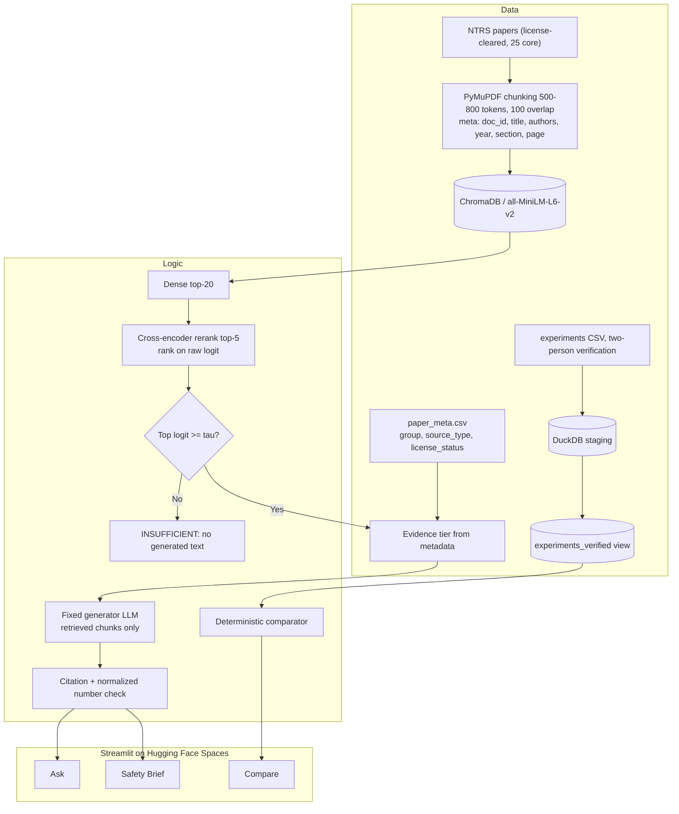

# CombustionLens: FINAL PLAN

**Status: LOCKED.** Changes are allowed only through the change-control rule in Section 0.

> **Hard rules (enforced everywhere)**
> 1. **Zero fabrication.** Every experiment name, run ID, number, unit, geometry, author and citation comes from an inspected source with paper title and page number.
> 2. **Null on ambiguity.** Unverified datum = `NULL`, displayed as "not verified".
> 3. **LLMs never put numbers into the comparison table.** All quantitative comparison data comes from the human-verified database.
> 4. **Synthesis, not operational advice.** Every output carries citations, an evidence tier, limitations and: *"Generated from published NASA research for informational/research purposes. Not validated for operational flight or terrestrial fire safety decisions."*
> 5. **Licensing discipline.** A paper enters the corpus only if its reuse status is recorded and clear. Unclear = excluded.

---

## 0. Lock and Change Control

This plan is final. It is changed only when one of these triggers fires, and every change is logged in `docs/change_log.md` with date, trigger, what changed and why:

| Allowed trigger | Typical response |
|---|---|
| Official challenge statement (tentatively Oct 28) differs from assumptions | Apply decision rules in 1.2 |
| Gate P1 or P2 fails (Section 11.2) | Drop to the Fallback or Floor data tier |
| Event checkpoint E1 (hour 8) shows too few verified rows | Switch demo plan per 4.2 |
| Demo pair fails verification | Substitute the best verified pair |
| Event date or pre-event coding rules turn out different | Adjust the calendar, not the scope |

**Provisional until confirmed (the only open items):** event date, pre-event coding permission, official statement contents, Hugging Face tier specs, demo pair choice, and real team size/roles.

---

## 1. Challenge Audit and Decision Rules

### 1.1 Status
The event date (mid-November 2026) and the official statement release (tentatively Oct 28) are **unconfirmed on the primary portal**. When the official text appears, run a line-by-line diff against this plan; **official text wins**. Log in `docs/diff_audit.md`.

### 1.2 Decision rules for the official statement
| If the statement... | Then |
|---|---|
| Supplies a dataset or API | It becomes the primary source; NTRS corpus becomes secondary context |
| Changes required deliverables | Keep Ask + Compare as the core; remap or drop Safety Brief |
| Forbids pre-event code | Continue survey/curation/planning only; code starts at event start |
| Names a mandatory tool, format or license | Comply first, adapt architecture second |
| Matches this plan | Proceed unchanged |

### 1.3 Assumptions (fill in real values at once)
- Team: **3 to 4 people** (roles in 11.1). With 2 people apply cuts in Section 2.
- Event length: about **48 hours**; phases are percentages so they rescale.
- No production app code before pre-event coding rules are confirmed.

### 1.4 Grounded fact vs. team choice
| Dimension | Published context | Team choice |
|---|---|---|
| Scope | AI dashboard to summarize, explore and interpret NASA microgravity combustion data for spacecraft fire safety | Ask, Compare, Safety Brief |
| Data | NASA microgravity combustion research (NTRS, PSI, ISS payloads) | 25-paper core corpus + hand-curated experiment table |
| Evaluation | Scientific utility, accuracy, reproducibility | Benchmark with 3 systems |
| Submission | Standard Space Apps package | 3-minute demo video |

---

## 2. Scope Control

**MVP (must ship):** Ask with page-level citations and a visible INSUFFICIENT state; Compare with guardrail cards; evidence tier + rank breakdown; structured Safety Brief; 20-question benchmark across 3 systems; public Space.

**Stretch (only after the 50% freeze gate):** CONFLICTING tier; corpus beyond 25 papers; benchmark to 30 questions; richer Earth-analog section.

**Cut:** tunable-weights UI; NLP independence/contradiction detection; probability calibration; alternate hosting.

**2-person cuts:** Safety Brief becomes a view inside Ask, benchmark 15 questions, data target 12 rows.

---

## 3. Architecture



The refusal state is built **first**, before any generation path.

---

## 4. Data Layer

### 4.1 Corpus (25-paper core)
- Query NTRS for microgravity combustion work (series to search: FLEX, BASS, Saffire, ACME and related). What exists and is usable is **decided by the survey**, not assumed.
- Log every query, hit count and decision in `docs/survey_log.md`; document PSI accessibility in `docs/data_sources.md`.
- **Inclusion criteria per paper:** full text available; license/reuse status recorded and clear; at least one locatable metric with stated conditions, or clear qualitative findings with page numbers.
- **Licensing rule:** record `license_status` (`public_domain_confirmed`, `restricted`, `unclear`). Only `public_domain_confirmed` papers enter the corpus. Others are excluded or used only as a private reading aid that is never indexed or quoted.
- Stretch: grow toward 40 papers only after Gate P2.

### 4.2 Minimum viable data target
| Level | Verified rows | Series | Demo capability |
|---|---|---|---|
| Target | 20 | 2 to 3 | One passing pair + one guardrail failure |
| Fallback | 10 | 2 | One of the two, with an honest coverage note |
| Floor | <10 | any | Lead with Ask, refusal and evaluation; Compare shows only what is verified plus a banner |

### 4.3 `paper_meta.csv`
Columns: `doc_id, title, authors, year, campaign_or_series, research_group_label, source_type, peer_reviewed (Y/N/unknown), license_status, notes`.
- `research_group_label` is human-assigned so "independent" is a lookup. Unknown = NULL.
- `source_type`: `flight`, `drop_tower`, `parabolic_flight`, `numerical`, `review`, `unknown`.

### 4.4 Experiment schema (`data/experiments.duckdb`)
Staging table fields: experiment_series, run_id, fuel, fuel_class, geometry, scale_dimension_raw, O2_value, O2_basis, diluent, pressure_raw_value, pressure_raw_unit, gravity_level, flow_regime, flow_velocity_cm_s, metric_name, metric_value_raw, metric_uncertainty_raw, metric_unit_raw, measurement_method, pressure_std_kPa, metric_value_std, metric_unit_std, conversion_provenance, source_paper, source_page, curated_by, verified_by, verified_date, doc_id, second_pass_agrees. Only identifying and condition fields are NOT NULL; all unverified values stay nullable.

```sql
CREATE VIEW experiments_verified AS
SELECT * FROM experiments_staging
WHERE verified_by IS NOT NULL
  AND verified_by <> curated_by
  AND metric_value_raw IS NOT NULL
  AND source_page IS NOT NULL;
```

- Unit conversion lives in `core/units.py` with unit tests; the factor is stored in `conversion_provenance`.
- **Agreement stat:** the verifier independently re-reads at least 30% of rows (all if fewer than 15); report percent agreement in `eval/results.md`.

---

## 5. Retrieval, Ranking and Generation

### 5.1 Retrieval
Bi-encoder `all-MiniLM-L6-v2` top-20, cross-encoder `ms-marco-MiniLM-L-6-v2` top-5. **Rank on raw logits.** The sigmoid is used only for a display label, "Normalized Cross-Encoder Relevance Score", never as a probability.

### 5.2 Refusal threshold
`tau_ce` (raw logit) is set on the dev half of the benchmark and reported on the held-out half. With only 10 to 15 held-out questions this is a **sanity check, not a generalization claim**; report counts next to percentages.

### 5.3 Rank score (fixed weights)
`Rank = 0.60 * s_rel + 0.25 * S_corrob + 0.15 * S_source`
Weights are **unvalidated defaults**, checked by ablation (relevance-only vs. full) and reported either way. `s_rel` is min-max normalized across the top-5.

| Independent groups (`S_corrob`) | Score |
|---|---|
| 0 / unknown | 0.00 |
| 1 | 0.33 |
| 2 | 0.67 |
| 3+ | 1.00 |

A curated contradiction flag subtracts 0.33 (floor 0).

| Source type (`S_source`) | Score |
|---|---|
| flight | 1.00 |
| drop_tower | 0.80 |
| parabolic_flight | 0.60 |
| numerical | 0.50 |
| review | 0.40 |
| unknown | 0.00 |

`S_source` is a **context prior** (representativeness of the target environment), not a truth ranking; the UI says so. The inspection panel shows every term and the arithmetic.

### 5.4 Generator model
One generator model is chosen on day 1 of the event, written to `config.yaml`, and used for **both** the naive RAG baseline and the full system, with identical temperature and prompt scaffolding apart from the system's extra components. The no-retrieval baseline uses the same model. Cache all calls (key = model + prompt hash). Keys live in Space secrets. Record model name and version in `eval/results.md`.

---

## 6. Evidence Tiers (metadata-driven, `core/evidence.py`)

Counts are of **distinct `research_group_label` values**, never chunks or paper totals.

| Tier | Rule |
|---|---|
| INSUFFICIENT | Top logit below `tau_ce`. No text generated. |
| WEAK | Support only from `review`/`unknown` sources or tangential sections |
| MODERATE | Supported by exactly **one independent group** (one or many papers) with at least one peer-reviewed source |
| STRONG | Supported by **2 or more independent groups**, no curated contradiction flag; boundary-condition similarity is displayed for the user, not auto-judged |
| CONFLICTING (stretch) | Curators flagged disagreement; parameter differences shown |

Agreement is described relative to reported uncertainties and boundary conditions; no universal numeric tolerance.

---

## 7. Comparator and Guardrails (`core/compare.py`)

Deterministic checks on verified rows, in order:
1. Fuel class and geometry must match, else **GUARDRAIL FAILURE**.
2. Flow regime must match (quiescent vs. forced), else **GUARDRAIL FAILURE**.
3. Oxygen basis harmonized (documented conversion); mismatch beyond a fuel-class limit shows **ATMOSPHERIC MISMATCH**. Limits are set only when a cited source supports them; otherwise show the raw difference and "no validated limit".
4. Pressure converted to kPa with provenance; unverified units/provenance = failure; large difference = **PRESSURE MISMATCH** warning.
5. Scale and sample thickness differences flagged as warnings with values.
6. Plot published uncertainty; otherwise "Uncertainty not reported".

States: `PASS`, `PASS WITH WARNINGS`, `GUARDRAIL FAILURE`. Failures are explicit cards, never silent hides.

**Demo pairs (candidates, unverified):** FLEX vs. FLEX-2 droplet burning rate constant (verify matching initial diameter, dilution and fiber diameter first); BASS-2 vs. Saffire as the guardrail-failure case (confirm against verified rows). If either fails inspection, substitute the best verified pair and say so in the script.

---

## 8. UI Specification

Build order: refusal state, Ask, Compare, Safety Brief.

**Ask**
- Page-level citations (paper title, page), tier badge, rank breakdown, normalized relevance score.
- **INSUFFICIENT state:** "No sufficiently relevant evidence in the corpus", nearest documents with scores, no answer.
- **Ambiguity handling:** if key conditions are missing (fuel, pressure, gravity, flow), ask for them instead of answering.
- **Number check (normalized):** each number in generated text is parsed with its unit and compared against numbers in cited chunks after unit normalization and rounding to the source's significant figures. A sentence whose numbers cannot be matched is hidden and logged. Generation is instructed to quote source values rather than restate them.

**Compare:** choose two verified experiments; guardrail cards, harmonized units, Plotly chart with error bars, provenance (paper, page, curator, verifier); "not verified" for nulls.

**Safety Brief (structured)**
1. Question and scope statement
2. Key findings, each with citation and tier
3. **Conditions of validity:** gravity level, atmosphere, pressure, flow, scale under which each finding was observed
4. **Earth-analog mapping:** which conditions differ in enclosed terrestrial settings and which findings may or may not transfer, labelled as hypothesis unless a cited source states it
5. Known limitations and gaps in the corpus
6. Disclaimer

**Global footer:** disclaimer, corpus size, number of verified rows, last data update.

---

## 9. Evaluation

### 9.1 Benchmark (`eval/questions.csv`)
Gold answers are human-written with paper and page citations, never LLM-generated.

| Category | Target (30) | Minimum (20) |
|---|---|---|
| Factual | 10 | 7 |
| Comparative (guardrail triggers) | 6 | 4 |
| Operational fire safety | 5 | 3 |
| Terrestrial transferability | 3 | 1 |
| Out-of-scope | 3 | 3 |
| Ambiguous | 3 | 2 |

Random dev/held-out split; record the seed.

### 9.2 Systems
A: generator model, no retrieval. B: naive RAG (dense top-5, no reranker, no gate, no evidence layer). C: full CombustionLens.

### 9.3 Metrics (blind grading, `eval/grade_sheet.csv`)
Factual accuracy, citation support, hallucination rate, appropriate refusal rate, comparability precision (100% required on verified rows), plus the ablation (relevance-only vs. full rank). Outputs shuffled, system labels hidden.

### 9.4 Limitations (must appear in `eval/results.md`)
- Team-written gold answers and team-curated data: **not independent**. State whether an outside grader was used.
- Small sample: report counts; no significance claims.
- Weights are untuned defaults; report ablation even if the full model does not win.

---

## 10. Hosting
- **Hugging Face Spaces (Streamlit SDK).** Previously documented free CPU specs were 2 vCPU / 16 GB; **re-verify before the event**.
- Pre-build the Chroma index and commit it or load from a dataset repo; no re-embedding on cold start.
- Profile peak RSS with `psutil` for cold start and a query; record in `docs/profiling.md`.
- Pinned `requirements.txt`, one-command local run, cached LLM outputs, backup demo recording.

---

## 11. END-TO-END EXECUTION PLAN

### 11.1 Roles (fill in names)
| Role | Owns |
|---|---|
| Data lead | Survey log, `paper_meta.csv`, license check, experiments CSV, DuckDB, unit tests |
| Verifier | Second-pass verification, agreement stat, benchmark gold answers |
| Backend/ML | Ingestion, retrieval, rerank, gate, tiers, baselines, eval runner |
| Frontend/Demo | Streamlit, Plotly, deployment, README, video, submission |

With 3 people the Verifier also takes evaluation; with 2, see Section 2.

### 11.2 Pre-event phase (Oct 12 to event start; no production app code unless rules allow)

| Window | Task | Owner | Output | Gate |
|---|---|---|---|---|
| Oct 12 to 14 | Confirm event date, rules and resource release on the primary portal; set up shared repo, folders, logs; get survey approval | All / Lead | `docs/event_status.md`, repo skeleton | Pre-event code rules recorded |
| Oct 14 to 20 | NTRS survey; shortlist candidates; record license status per paper; PSI accessibility audit | Data lead | `docs/survey_log.md`, `docs/data_sources.md`, candidate list | **Gate P1:** 25 license-cleared candidates, else widen search |
| Oct 20 to 27 | Fill `paper_meta.csv` (group labels, source types); start experiment CSV with page numbers; draft 20 questions and gold answers | Data lead, Verifier | `paper_meta.csv`, first 10+ rows, draft `questions.csv` | Group labels exist for all 25 core papers |
| Oct 28 to 30 | Official statement diff audit using Section 1.2 | Lead | `docs/diff_audit.md` | Scope confirmed or revised |
| Oct 30 to Nov 6 | Second-pass verification; compute agreement; verify demo pair candidates; finalize benchmark | Verifier, Data lead | Verified rows, agreement %, final pairs | **Gate P2:** count verified rows; choose Target / Fallback / Floor |
| Nov 6 to event | Rehearse roles, re-check Space tier specs, prepare accounts and keys, dry-run the schedule | All | Checklist complete | Everyone knows their first 6 hours |

If the event is earlier than mid-November, compress by cutting corpus size first, then benchmark questions, never the verification step.

### 11.3 Event window (percent of total time; worked example for 48 h)

| % of event | Example hours | Work | Exit criterion |
|---|---|---|---|
| 0 to 4% | 0 to 2 | Confirm official rules, set up repo/env, load corpus, choose generator model | Everyone running the app skeleton |
| 4 to 13% | 2 to 6 | Ingestion, Chroma index, dense retrieval; parallel: finish curation | Query returns chunks with page numbers |
| 13 to 21% | 6 to 10 | Cross-encoder, refusal gate, **INSUFFICIENT UI first** | Out-of-scope query refuses |
| **17%** | **Hour 8** | **Checkpoint E1:** count verified rows, pick Target/Fallback/Floor | Decision logged |
| 21 to 33% | 10 to 16 | Ask page: citations, tiers, rank breakdown, number check | **Demo-ready Ask** |
| 25 to 42% | 12 to 20 | Comparator, unit tests, Compare page, guardrail cards | **Demo-ready Compare** by 42% |
| 42 to 54% | 20 to 26 | Safety Brief; baselines A and B; eval runner | All three systems answer all questions |
| **50%** | **Hour 24** | **FEATURE FREEZE** | Only fixes, evaluation, polish |
| 50 to 67% | 24 to 32 | Run benchmark, blind grading, ablation, write `eval/results.md` | Results table + limitations done |
| 67 to 79% | 32 to 38 | Deploy to Space, profile memory, bug fixes, README | Public URL works on a fresh browser |
| 79 to 92% | 38 to 44 | Record demo video plus backup; fill submission form | Video under 3 minutes |
| 92 to 100% | 44 to 48 | Buffer, final checklist, **submit early** | Submitted before deadline |

**Slip rule:** if Compare is not demo-ready by 42%, switch to the fallback demo and shrink the Safety Brief to its minimal form.

### 11.4 Rhythm during the event
- 5-minute standup at the start of each block: blockers, next exit criterion.
- Every 6 hours: merge to main and run the smoke tests.
- Data lead and Frontend lead jointly enforce the freeze.

### 11.5 Smoke tests (before every merge after 25%)
1. Out-of-scope query returns INSUFFICIENT with no generated text.
2. A known question returns a cited answer with correct page numbers.
3. A known guardrail-failure pair shows the failure card.
4. A null field renders "not verified".
5. The disclaimer appears on every page.

---

## 12. Demo Script (about 3 minutes)

| Time | Content |
|---|---|
| 0:00 to 0:15 | Problem: scattered literature, and why generic AI is untrustworthy here |
| 0:15 to 1:15 | **Ask:** cited answer with tier; an out-of-scope refusal; rank breakdown |
| 1:15 to 2:15 | **Compare:** a passing pair with error bars, then a guardrail failure |
| 2:15 to 2:45 | **Safety Brief** with conditions of validity and the disclaimer |
| 2:45 to 3:00 | **Evaluation:** held-out results with counts and limitations; one line on integrity rules |

Film only comparisons that were actually verified.

---

## 13. Risk Register

| Risk | Likelihood | Mitigation |
|---|---|---|
| Too few license-cleared papers | Medium | Widen NTRS queries; use reading-only papers for curation context without indexing them |
| Too few verified rows | High | Fallback/Floor plans; lead with Ask + refusal + eval |
| Official statement differs | Medium | Decision rules 1.2; diff audit |
| Pre-event code forbidden | Medium | Plan is code-free until confirmed |
| Demo pair fails verification | Medium | Substitute best verified pair |
| Hallucinated numbers | Medium | Normalized number check; hide failures |
| LLM API outage or limits | Medium | Cache, backup recording |
| Memory or cold-start trouble | Low-Medium | Pre-built index, profiling |
| Teammate drops out | Medium | 2-person cuts |
| Scope creep after freeze | High | 50% freeze enforced |

---

## 14. Submission Checklist
- [ ] Official statement diff done and logged
- [ ] Survey log, data sources, profiling, change log docs present
- [ ] `paper_meta.csv` with license status for every indexed paper
- [ ] Verified rows with page numbers, verifier names, agreement %
- [ ] Refusal, ambiguity and guardrail-failure behaviors demonstrated
- [ ] `questions.csv`, `grade_sheet.csv`, `results.md` (limitations and generator model recorded)
- [ ] Public Space tested on a fresh browser
- [ ] README (setup, architecture, data provenance, disclaimer)
- [ ] Demo video under 3 minutes plus backup
- [ ] Licenses and attributions reviewed

---

## 15. Definition of Done
A stranger can open the Space, ask a question, receive a cited answer with a tier or a clean refusal, compare two verified experiments (and watch the system refuse an invalid pair), and read an evaluation that honestly states what was and was not shown.
